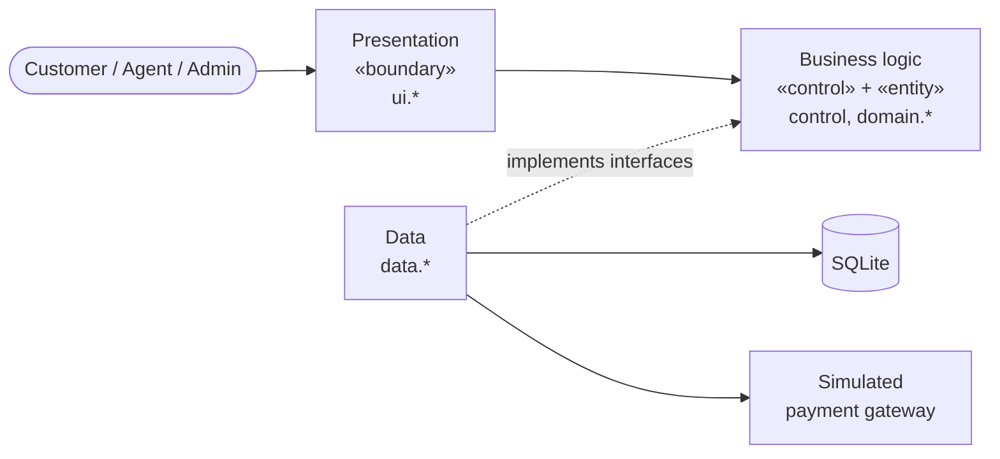

# Flight Reservation System — Design Diagrams

ENSF 614 term project, design phase (§7.1 of [the brief](../ENSF_614_Term_Project.pdf)). Every diagram is Mermaid
inside Markdown, so it renders on GitHub and in VS Code and stays under version control next to the code.

All diagrams are drawn from the implemented source in `src/main/java/ca/ucalgary/frs`, so class names, methods,
states and rules match the running application.

## Catalogue

| § | Artefact | File | Mermaid type |
|---|---|---|---|
| A | Activity 1: Login process | [activity/login_activity.md](activity/login_activity.md) | `flowchart` |
| A | Activity 2: Browsing for and selecting a flight | [activity/flight_search_activity.md](activity/flight_search_activity.md) | `flowchart` |
| A | Activity 3: Booking a flight | [activity/flight_booking_activity.md](activity/flight_booking_activity.md) | `flowchart` |
| A | Activity 4: Making a payment | [activity/payment_activity.md](activity/payment_activity.md) | `flowchart` |
| B | System use-case diagram (22 use cases, 3 roles, 2 secondary actors) | [usecase/use_case_diagram.md](usecase/use_case_diagram.md) | `flowchart` |
| C | Use-case scenarios (4, with underlined classes and double-underlined operations) | [usecase/use_case_scenarios.md](usecase/use_case_scenarios.md) | Markdown |
| D | Sequence 1: Log in (`AuthController`) | [sequence/login_sequence.md](sequence/login_sequence.md) | `sequenceDiagram` |
| D | Sequence 2: Search flights (`FlightSearchController`) | [sequence/flight_search_sequence.md](sequence/flight_search_sequence.md) | `sequenceDiagram` |
| D | Sequence 3: Book a flight (`BookingController`) | [sequence/flight_booking_sequence.md](sequence/flight_booking_sequence.md) | `sequenceDiagram` |
| D | Sequence 4: Make a payment (`PaymentController`) | [sequence/payment_sequence.md](sequence/payment_sequence.md) | `sequenceDiagram` |
| E | State 1: Overall system | [state/system_state_machine.md](state/system_state_machine.md) | `stateDiagram-v2` |
| E | State 2: Payment process (+ `Payment` object lifecycle) | [state/payment_state_machine.md](state/payment_state_machine.md) | `stateDiagram-v2` |
| E | State 3: Reservation object | [state/reservation_state_machine.md](state/reservation_state_machine.md) | `stateDiagram-v2` |
| E | State 4 (supplementary): Flight object | [state/flight_state_machine.md](state/flight_state_machine.md) | `stateDiagram-v2` |
| F | Class diagram: overview + entity, control, boundary and data-access views + design patterns | [class/domain_class_diagram.md](class/domain_class_diagram.md) | `classDiagram` |
| G | Package diagram: three layers, classes per package, public vs package-private | [package/package_diagram.md](package/package_diagram.md) | `flowchart` |

## Architecture in one picture

## Traceability matrix

How each use case flows through the design artefacts. Use-case IDs are defined in the
[use-case diagram](usecase/use_case_diagram.md#use-case-catalogue).

| Use case | Scenario | Activity | Sequence | Control class | Boundary classes | Main entities | State machine |
|---|---|---|---|---|---|---|---|
| UC-01 Log in | [4](usecase/use_case_scenarios.md#scenario-4--uc-01-log-in) | [1](activity/login_activity.md) | [1](sequence/login_sequence.md) | `AuthController` | `LoginView`, `MainFrame` | `User`, `Role`, `Permission` | [System](state/system_state_machine.md) |
| UC-02 Log out | — | — | — | `AuthController` | `MainFrame` | `User` | [System](state/system_state_machine.md) |
| UC-03 Register | — | [1](activity/login_activity.md) | — | `AuthController` | `RegisterDialog` | `Customer`, `CustomerUser` | [System](state/system_state_machine.md) |
| UC-04 Search for flights | [1](usecase/use_case_scenarios.md#scenario-1--uc-04-search-for-flights-and-select-one) | [2](activity/flight_search_activity.md) | [2](sequence/flight_search_sequence.md) | `FlightSearchController` | `FlightSearchPage` | `Flight`, `Route`, `Airport`, `Airline`, `FlightAvailability` | [Flight](state/flight_state_machine.md) |
| UC-05 View flight details and seats | [1](usecase/use_case_scenarios.md#scenario-1--uc-04-search-for-flights-and-select-one) | [2](activity/flight_search_activity.md) | [2](sequence/flight_search_sequence.md) | `FlightSearchController` | `BookingDialog`, `SeatMapPanel` | `Aircraft`, `Seat`, `SeatClass`, `SeatMap` | — |
| UC-06 Book a flight | [2](usecase/use_case_scenarios.md#scenario-2--uc-06-book-a-flight) | [3](activity/flight_booking_activity.md) | [3](sequence/flight_booking_sequence.md) | `BookingController` | `BookingDialog`, `ConfirmationDialog` | `Reservation`, `FareQuote`, `Customer`, `Promotion` | [Reservation](state/reservation_state_machine.md) |
| UC-07 Make a payment | [3](usecase/use_case_scenarios.md#scenario-3--uc-07-make-a-payment) | [4](activity/payment_activity.md) | [4](sequence/payment_sequence.md) | `PaymentController` | `PaymentDialog` | `Payment`, `CardDetails`, `Reservation` | [Payment](state/payment_state_machine.md), [Reservation](state/reservation_state_machine.md) |
| UC-08 Cancel a reservation | — | — | — | `BookingController` | `MyTripsPage`, `ReservationsPage` | `Reservation`, `Payment` (refund) | [Reservation](state/reservation_state_machine.md) |
| UC-09 Modify a reservation | — | — | — | `BookingController` | `ModifyReservationDialog` | `Reservation`, `Flight`, `Seat`, `FareQuote` | [Reservation](state/reservation_state_machine.md) |
| UC-10 View reservations | — | — | — | `BookingController`, `CustomerController` | `MyTripsPage`, `ReservationsPage` | `Reservation` | — |
| UC-11 Booking confirmation | [2](usecase/use_case_scenarios.md#scenario-2--uc-06-book-a-flight) | [3](activity/flight_booking_activity.md) | [3](sequence/flight_booking_sequence.md) | `BookingController` | `ConfirmationDialog` | `BookingConfirmation` | — |
| UC-12 View payment history | — | — | — | `CustomerController`, `PaymentController` | `ProfilePage`, `CustomersPage` | `Payment` | [Payment](state/payment_state_machine.md) |
| UC-13 Edit own profile | — | — | — | `CustomerController` | `ProfilePage` | `Customer` | — |
| UC-14 Manage customer profiles | — | — | — | `CustomerController` | `CustomersPage`, `CustomerEditorDialog` | `Customer` | — |
| UC-15 View flight schedules | — | — | — | `FlightSearchController` | `SchedulePage` | `Flight`, `FlightAvailability` | [Flight](state/flight_state_machine.md) |
| UC-16 Manage flights | — | — | — | `FlightManagementController` | `FlightsPage`, `FlightEditorDialog` | `Flight`, `Reservation` | [Flight](state/flight_state_machine.md) |
| UC-17 Remove outdated flights | — | — | — | `FlightManagementController` | `FlightsPage` | `Flight` | [Flight](state/flight_state_machine.md) |
| UC-18 Manage routes | — | — | — | `RouteAndAircraftController` | `RoutesPage`, `RouteEditorDialog` | `Route`, `Airport` | — |
| UC-19 Manage aircraft | — | — | — | `RouteAndAircraftController` | `AircraftPage`, `AircraftEditorDialog` | `Aircraft` | — |
| UC-20 Monthly promotion | [4](usecase/use_case_scenarios.md#scenario-4--uc-01-log-in) | [1](activity/login_activity.md) | [1](sequence/login_sequence.md) | `PromotionController` | `PromotionDialog`, `MainFrame` | `Promotion` | [System](state/system_state_machine.md) |
| UC-21 Process refund | — | [4](activity/payment_activity.md) (notes) | — | `PaymentController` | — | `Payment` (REFUND) | [Payment](state/payment_state_machine.md) |
| UC-22 Release expired holds | [2](usecase/use_case_scenarios.md#scenario-2--uc-06-book-a-flight) (10b) | [3](activity/flight_booking_activity.md) | — | `BookingController` | `MainFrame` (timer) | `Reservation` | [Reservation](state/reservation_state_machine.md), [System](state/system_state_machine.md) |

## Requirements coverage

| Brief requirement | Use cases |
|---|---|
| 3.1 Flight search and viewing | UC-04, UC-05 |
| 3.2 Booking management | UC-06, UC-08, UC-09, UC-11 |
| 3.3 Customer management | UC-03, UC-13, UC-14 |
| 3.4 Flight management (admin only) | UC-16, UC-17 (+ UC-18, UC-19 from §2.1) |
| 3.5 Payment simulation | UC-07, UC-12, UC-21 |
| 3.6 Database connectivity | Data layer ([package diagram](package/package_diagram.md), [F.4](class/domain_class_diagram.md#f4-data-access-layer)) |
| 3.7 Monthly promotional news | UC-20 |

## Where the diagrams differ from the implementation plan

The plan in `uml_mermaid_implementation_plan.md` was written before the code. The diagrams follow the code, so:

| Plan said | Diagrams show | Why |
|---|---|---|
| `LoginController` | `AuthController` | The class that exists; it also covers log out and registration |
| Flight states `Boarding`, `In-Flight`, `Landed` | `SCHEDULED`, `DELAYED`, `CANCELLED`, plus derived *Departed* | The app stores only these; live flight operations are not in the brief |
| Use cases *Audit system logs*, *Manage seat inventory* | Left out | Not implemented. Seat inventory comes from the aircraft layout and live reservations |
| Singleton for a connection pool | Singleton for the reservation state objects | SQLite uses one connection per transaction; no pool exists |
| Strategy for payment calculation | Strategy for discount, refund, confirmation format and payment gateway | Those are the interchangeable policies in the code |
| Use-case diagram as `quadrantChart` | `flowchart` | A quadrant chart cannot show actors and associations |
| Three scenarios | Four scenarios | One per sequence diagram, so every sequence has a written scenario |

## Viewing and exporting

- **GitHub / VS Code:** open any `.md` file; Mermaid renders natively (VS Code needs the built-in Markdown preview or
  the *Markdown Preview Mermaid Support* extension).
- **Images for the PDF report:** `npx -p @mermaid-js/mermaid-cli mmdc -i file.md -o file.svg` renders every diagram in
  a Markdown file. All diagrams in this folder were checked to render with mermaid-cli 11.4.
