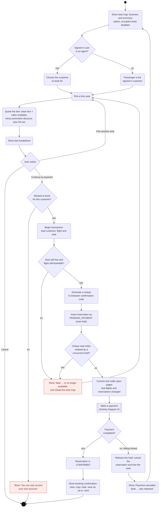

# Activity Diagram 3 — Booking a Flight

| | |
|---|---|
| **Deliverable** | 7.1 A, activity diagram 3 (booking a flight) |
| **Use cases** | UC-06 Book a flight (includes UC-07 Make a payment) |
| **Control class** | `BookingController` (`quote`, `holdSeat`, `pay`, `releaseHold`, `confirmation`) |
| **Boundary classes** | `BookingDialog`, `SeatMapPanel`, `FareBreakdown`, `PaymentDialog`, `ConfirmationDialog` |
| **Related diagrams** | [Booking sequence](../sequence/flight_booking_sequence.md), [Reservation state machine](../state/reservation_state_machine.md) |

## Description

Booking happens in two steps so that two people can never pay for the same seat:

1. **Hold the seat.** A `Reservation` is created in `PENDING_PAYMENT` state. A unique database index on
   *(flight, seat)* for live reservations guarantees only one hold can exist per seat, even if two bookings race.
2. **Pay.** The payment dialog opens (see [Activity Diagram 4](payment_activity.md)). Payment confirms the
   reservation. Closing the dialog without paying releases the hold at once; an abandoned hold is released
   automatically after 15 minutes.

A flight agent books on behalf of a customer and picks the customer first. A customer always books for themselves.

## Diagram

## Notes

- **Fare rules (`FareCalculator`):** Business costs 2.5 × the base fare, Economy 1.0 ×. The monthly promotion
  (`PercentageDiscountPolicy`) takes its percentage off the fare before tax. Tax is 5%. Money is held as integer cents.
- **Hold expiry:** `BookingController.runHousekeeping()` runs at start-up and every 60 s. It cancels any hold older
  than 15 minutes (`HOLD_EXPIRY`) and marks confirmed trips whose flight has departed as `COMPLETED`.
- **Events:** after a commit the controller publishes `RESERVATIONS` and `FLIGHTS` on the `EventBus`, so open
  tables (search results, My trips, agent reservations) reload without a manual refresh.
