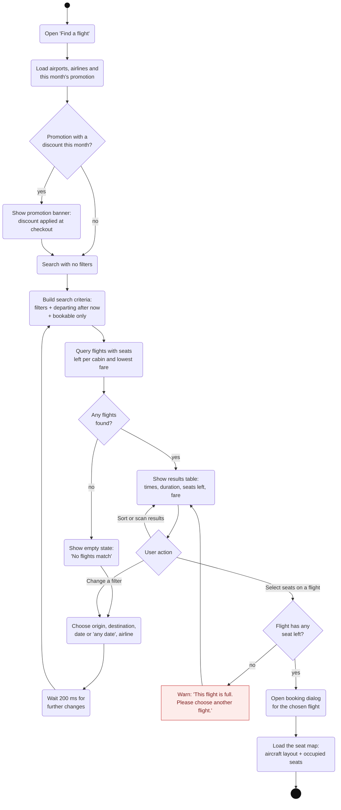

# Activity Diagram 2 — Browsing for and Selecting a Flight

| | |
|---|---|
| **Deliverable** | 7.1 A, activity diagram 2 (browsing for and selecting a flight) |
| **Use cases** | UC-04 Search for flights, UC-05 View flight details and seat availability |
| **Control class** | `FlightSearchController` (`airports`, `airlines`, `search`, `seatMap`), `PromotionController` |
| **Boundary classes** | `FlightSearchPage`, `BookingDialog`, `SeatMapPanel` |
| **Related diagrams** | [Flight search sequence](../sequence/flight_search_sequence.md), [Booking activity](flight_booking_activity.md) |

## Description

A signed-in customer or flight agent opens **Find a flight**. The page loads the airports, airlines and this month's
promotion, then immediately lists every bookable flight. Each change to a filter (origin, destination, date or
"any date", airline) re-runs the search after a 200 ms pause, so typing and clicking never stutter.

Only *bookable* flights are listed: not cancelled and departing after now. Each row shows the flight number,
airline, route, departure and arrival times, duration, seats left per cabin and the lowest available fare. Choosing
**Select seats** on a flight that still has seats opens the booking dialog with that flight's live seat map.

## Diagram

The flow continues in [Activity Diagram 3 — Booking a Flight](flight_booking_activity.md).

## Notes

- **Filters are optional.** Any filter left at "Any" is ignored, so the first search lists every bookable flight.
- **Result limit:** at most 500 rows are shown; the count label says "Showing the first 500 flights" when capped.
- **Seat counts** come from the database: a seat is occupied when a reservation on that flight is
  `PENDING_PAYMENT` or `CONFIRMED`.
- **Agents** use the same page. Administrators can search but book nothing; they use the schedule views instead.
