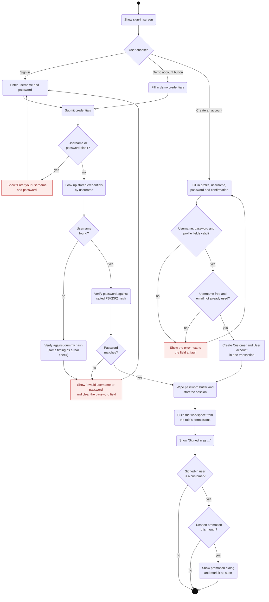

# Activity Diagram 1 — Login Process

| | |
|---|---|
| **Deliverable** | 7.1 A, activity diagram 1 (login process) |
| **Use cases** | UC-01 Log in, UC-03 Register as a customer, UC-20 Receive monthly promotion |
| **Control class** | `AuthController` (`login`, `registerCustomer`), `PromotionController` |
| **Boundary classes** | `LoginView`, `RegisterDialog`, `MainFrame`, `PromotionDialog` |
| **Related diagrams** | [Login sequence](../sequence/login_sequence.md), [System state machine](../state/system_state_machine.md) |

## Description

The sign-in screen is the first thing every user sees. A user signs in with a username and password, uses a
one-click demo account button, or (customers only) creates a new account. Credentials are checked against a salted
PBKDF2 hash. An unknown username is checked against a dummy hash so both failures take the same time and give the same
message. The password buffer is wiped after every attempt.

On success the `Session` changes, and `MainFrame` builds a workspace containing only the pages the user's role allows.
A customer who has not yet seen this month's promotion is shown it once.

## Diagram

## Notes

- **Validation rules (registration):** username is 3–30 characters (letters, digits, `.`, `-`, `_`); password is at
  least 8 characters with a letter and a digit; the confirmation must match.
- **Concurrency:** the credential check runs off the Swing event thread through `BackgroundTask`. The sign-in button
  shows "Signing in…" and is disabled until the check finishes.
- **Errors:** shown in an inline banner (`Banner`) above the form, never in a blocking pop-up.
