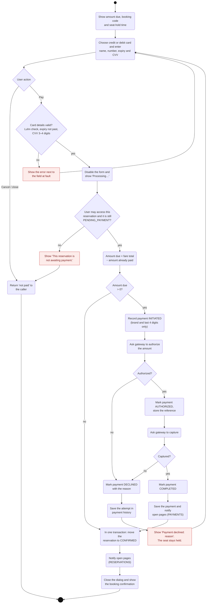

# Activity Diagram 4 — Making a Payment

| | |
|---|---|
| **Deliverable** | 7.1 A, activity diagram 4 (making a payment) |
| **Use cases** | UC-07 Make a payment (included by UC-06 Book a flight, extends UC-09 Modify a reservation) |
| **Control class** | `PaymentController` (`payReservation`, `charge`, `amountPaid`), reached through `BookingController.pay` |
| **Boundary classes** | `PaymentDialog` |
| **External actor** | Payment gateway (simulated by `SimulatedPaymentGateway`) |
| **Related diagrams** | [Payment sequence](../sequence/payment_sequence.md), [Payment state machine](../state/payment_state_machine.md) |

## Description

The payment dialog shows the amount due and the time the seat is held. The user chooses credit or debit card and
enters the name on the card, card number, expiry (MM/YY) and CVV. The card is validated on the form first
(Luhn checksum, expiry not in the past, 3–4 digit CVV), so obvious mistakes never reach the gateway.

Every attempt is recorded as a `Payment`, including declines, so payment history shows exactly what happened. Only
the card brand and last four digits are stored; the full number and CVV are never saved.

Payment processing is simulated (requirement 3.5). Card `4242 4242 4242 4242` is approved; cards ending in `0002`
(insufficient funds) or `0069` (reported stolen) and amounts over $10,000 are declined.

## Diagram

## Notes

- **What "not paid" means depends on the caller.** When booking, the hold is released
  ([Activity Diagram 3](flight_booking_activity.md)). When modifying a reservation to a more expensive seat or flight,
  the change is not made.
- **Refunds** follow the same record-then-call-gateway pattern (`PaymentController.refund`): a `REFUND` payment is
  created, approved by the gateway and completed. When everything paid has been returned, the original charges are
  marked `REFUNDED`.
- **Concurrency:** the gateway call runs in a `BackgroundTask` off the event thread; the simulated gateway waits
  700 ms so the progress state is visible.
