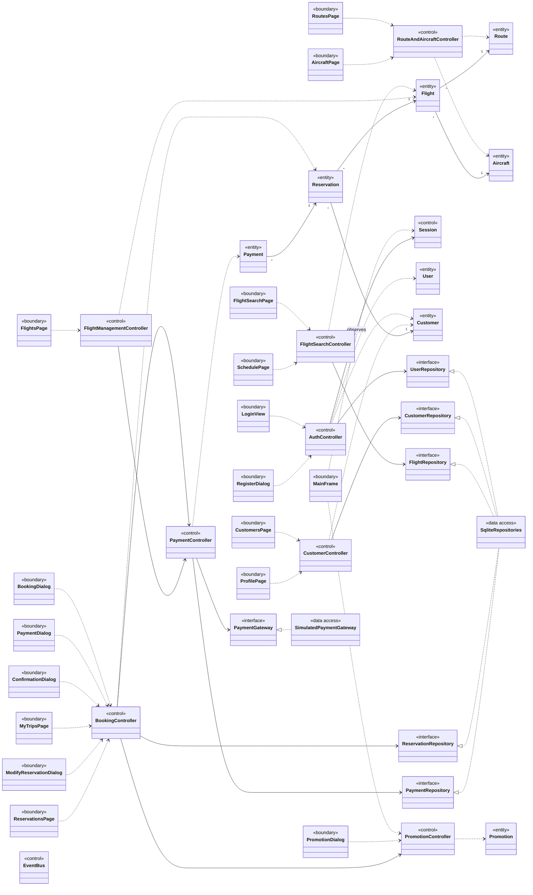
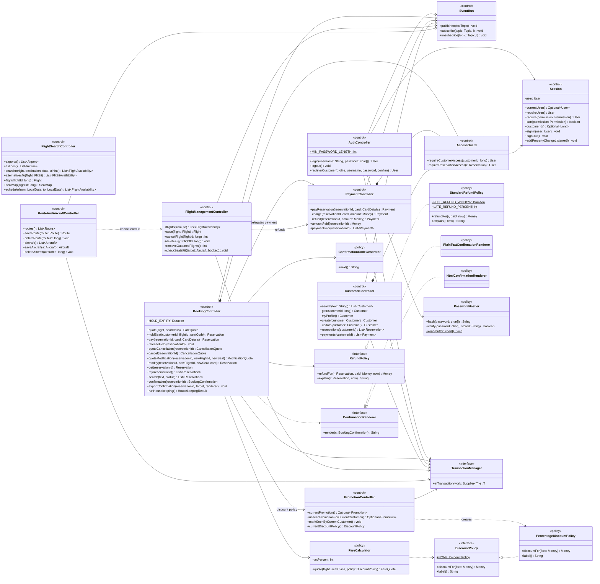
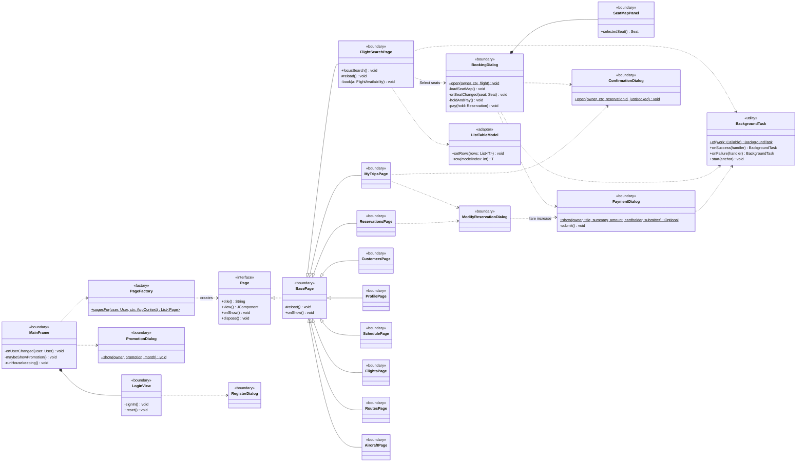

# Class Diagram

| | |
|---|---|
| **Deliverable** | 7.1 F, class diagram (classes, relationships, attributes, behaviours, cardinalities, stereotypes) |
| **Source** | `src/main/java/ca/ucalgary/frs/**` |
| **Related** | [Package diagram](../package/package_diagram.md), [Use-case scenarios](../usecase/use_case_scenarios.md), [Traceability matrix](../README.md#traceability-matrix) |

## How to read this document

The full model has more than 80 classes, which is unreadable as one picture. It is presented as one integrated
**overview** (every architectural class, names and relationships only) followed by four **detailed views** that show
attributes and operations:

| View | Contents |
|---|---|
| [F.0 Overview](#f0-integrated-overview) | All boundary, control, entity and data-access classes and how the layers connect |
| [F.1 Entity model](#f1-entity-model) | Domain entities and value objects, with multiplicities, inheritance and the Reservation State pattern |
| [F.2 Control classes](#f2-control-classes-and-policies) | One control class per major use case, the policies (Strategy) they use, and the interfaces they depend on |
| [F.3 Boundary classes](#f3-boundary-classes) | Swing pages and dialogs and the control classes each one calls |
| [F.4 Data access](#f4-data-access-layer) | Repository and gateway interfaces (business layer) realized by SQLite classes (data layer) |

**Conventions**

- Stereotypes: `«boundary»` (GUI), `«control»` (use-case coordination), `«entity»` (domain data and rules),
  `«interface»`, `«enumeration»`, `«data access»`, `«policy»` (interchangeable business rule, Strategy).
- Visibility: `+` public, `-` private, `#` protected, `~` package. `$` marks static, `*` marks abstract.
- Constructors, getters, setters, `equals`/`hashCode`/`toString` and Java library types (`String`, `List`, exceptions,
  Swing widgets) are left out, as the brief allows.
- `Money` is a domain value type (integer cents) and appears as an attribute type only.

---

## F.0 Integrated overview

`SqliteRepositories` stands for the ten `Sqlite*Repository` classes detailed in [F.4](#f4-data-access-layer).
Every control class also publishes to `EventBus`; those arrows are omitted here to keep the picture legible.

---

## F.1 Entity model

```mermaid
classDiagram
    direction TB

    class User {
        <<entity>>
        <<abstract>>
        -id: long
        -username: String
        -fullName: String
        -email: String
        +role()* Role
        +permissions() Set~Permission~
        +can(permission: Permission) boolean
    }
    class CustomerUser {
        <<entity>>
        -customerId: long
        +role() Role
    }
    class FlightAgent {
        <<entity>>
        +role() Role
    }
    class SystemAdministrator {
        <<entity>>
        +role() Role
    }
    class UserFactory {
        <<factory>>
        +create(role, id, username, fullName, email, customerId)$ User
    }
    class Role {
        <<enumeration>>
        CUSTOMER
        AGENT
        ADMIN
        -displayName: String
        -permissions: Set~Permission~
    }
    class Permission {
        <<enumeration>>
        SEARCH_FLIGHTS
        BOOK_FLIGHTS
        VIEW_OWN_RESERVATIONS
        EDIT_OWN_PROFILE
        MANAGE_CUSTOMERS
        MANAGE_ALL_RESERVATIONS
        VIEW_SCHEDULES
        MANAGE_FLIGHTS
        MANAGE_ROUTES_AND_AIRCRAFT
    }

    class Customer {
        <<entity>>
        -id: Long
        -firstName: String
        -lastName: String
        -email: String
        -phone: String
        -dateOfBirth: LocalDate
        -address: String
        -createdAt: LocalDateTime
        +fullName() String
        +builder()$ Customer.Builder
    }

    class Airport {
        <<entity>>
        -code: String
        -name: String
        -city: String
        -country: String
        +label() String
    }
    class Airline {
        <<entity>>
        -code: String
        -name: String
    }
    class Route {
        <<entity>>
        -id: Long
        -distanceKm: int
        +label() String
    }
    class Aircraft {
        <<entity>>
        -id: Long
        -registration: String
        -model: String
        -businessRows: int
        -economyRows: int
        -seatsPerRow: int
        +capacity() int
        +capacity(seatClass: SeatClass) int
        +classOfRow(row: int) SeatClass
        +allSeats() List~Seat~
        +seat(code: String) Optional~Seat~
        +requireSeat(code: String) Seat
    }
    class Seat {
        <<entity>>
        -row: int
        -letter: char
        +code() String
        +parse(code: String)$ int[]
    }
    class SeatClass {
        <<enumeration>>
        ECONOMY
        BUSINESS
        -fareMultiplier: BigDecimal
    }
    class Flight {
        <<entity>>
        -id: Long
        -flightNumber: String
        -departureTime: LocalDateTime
        -arrivalTime: LocalDateTime
        -baseFare: Money
        -status: FlightStatus
        +duration() Duration
        +hasDeparted(now: LocalDateTime) boolean
        +isBookable(now: LocalDateTime) boolean
        +fareFor(seatClass: SeatClass) Money
        +builder()$ Flight.Builder
    }
    class FlightStatus {
        <<enumeration>>
        SCHEDULED
        DELAYED
        CANCELLED
    }
    class SeatMap {
        <<entity>>
        -occupiedSeatCodes: Set~String~
        +isAvailable(seat: Seat) boolean
        +availableCount(seatClass: SeatClass) long
    }
    class FlightAvailability {
        <<entity>>
        -economyAvailable: int
        -businessAvailable: int
        +totalAvailable() int
        +loadFactorPercent() int
        +lowestFare() Money
    }

    class Reservation {
        <<entity>>
        -id: Long
        -confirmationCode: String
        -createdAt: LocalDateTime
        -updatedAt: LocalDateTime
        -bookedByUserId: Long
        +hold(code, customer, flight, seat, fare, now, bookedBy)$ Reservation
        +confirm(now: LocalDateTime) void
        +cancel(now: LocalDateTime) void
        +modify(newFlight, newSeat, newFare, now) void
        +complete(now: LocalDateTime) void
        +holdsSeat() boolean
        +isOwnedBy(customerId: long) boolean
        +status() ReservationStatus
        ~transitionTo(next: ReservationState) void
    }
    class ReservationState {
        <<interface>>
        +status() ReservationStatus
        +holdsSeat() boolean
        +confirm(r: Reservation) void
        +cancel(r: Reservation) void
        +checkModifiable(r: Reservation) void
        +complete(r: Reservation) void
    }
    class PendingPaymentState {
        <<entity>>
        ~INSTANCE: PendingPaymentState$
    }
    class ConfirmedState {
        <<entity>>
        ~INSTANCE: ConfirmedState$
    }
    class CancelledState {
        <<entity>>
        ~INSTANCE: CancelledState$
    }
    class CompletedState {
        <<entity>>
        ~INSTANCE: CompletedState$
    }
    class ReservationStatus {
        <<enumeration>>
        PENDING_PAYMENT
        CONFIRMED
        CANCELLED
        COMPLETED
        +state() ReservationState
    }
    class FareQuote {
        <<entity>>
        -fare: Money
        -discount: Money
        -tax: Money
        -total: Money
        -promotionTitle: String
        +hasDiscount() boolean
    }

    class Payment {
        <<entity>>
        -id: Long
        -reservationId: long
        -type: PaymentType
        -amount: Money
        -method: PaymentMethodType
        -cardBrand: String
        -cardLast4: String
        -cardholderName: String
        -status: PaymentStatus
        -transactionRef: String
        -failureReason: String
        -createdAt: LocalDateTime
        +initiate(reservationId, type, amount, card, now)$ Payment
        +initiateRefund(charge, amount, now)$ Payment
        +authorize(ref: String) void
        +complete() void
        +decline(reason: String) void
        +markRefunded() void
        +netEffect() Money
        +maskedCard() String
    }
    class PaymentStatus {
        <<enumeration>>
        INITIATED
        AUTHORIZED
        DECLINED
        COMPLETED
        REFUNDED
        +next() Set~PaymentStatus~
        +canMoveTo(target: PaymentStatus) boolean
    }
    class PaymentType {
        <<enumeration>>
        CHARGE
        REFUND
    }
    class PaymentMethodType {
        <<enumeration>>
        CREDIT_CARD
        DEBIT_CARD
    }
    class CardDetails {
        <<entity>>
        -cardholderName: String
        -number: String
        -expiry: YearMonth
        -cvv: String
        +last4() String
        +brand() String
        +luhnValid(digits: String)$ boolean
    }
    class Promotion {
        <<entity>>
        -id: Long
        -title: String
        -description: String
        -discountPercent: int
        -active: boolean
    }
    class BookingConfirmation {
        <<entity>>
        -amountPaid: Money
        -generatedAt: LocalDateTime
    }

    User <|-- CustomerUser
    User <|-- FlightAgent
    User <|-- SystemAdministrator
    UserFactory ..> User : creates
    User ..> Role : role()
    Role "1" o-- "*" Permission : grants
    CustomerUser "0..1" --> "1" Customer : profile

    Route "*" --> "1" Airport : origin
    Route "*" --> "1" Airport : destination
    Flight "*" --> "1" Airline : operated by
    Flight "*" --> "1" Route : flies
    Flight "*" --> "1" Aircraft : uses
    Flight --> FlightStatus
    Aircraft "1" *-- "*" Seat : layout
    Seat --> SeatClass
    SeatMap "1" --> "1" Flight
    FlightAvailability "1" --> "1" Flight

    Reservation "*" --> "1" Customer : for
    Reservation "*" --> "1" Flight : on
    Reservation "1" --> "1" Seat : holds
    Reservation "1" *-- "1" FareQuote : priced by
    Reservation "*" --> "1" ReservationState : current state
    ReservationState <|.. PendingPaymentState
    ReservationState <|.. ConfirmedState
    ReservationState <|.. CancelledState
    ReservationState <|.. CompletedState
    ReservationState ..> ReservationStatus
    FareQuote --> SeatClass
    FareQuote "*" ..> "0..1" Promotion : discount from

    Payment "*" --> "1" Reservation : settles
    Payment --> PaymentStatus
    Payment --> PaymentType
    Payment --> PaymentMethodType
    Payment ..> CardDetails : initiated from
    CardDetails --> PaymentMethodType

    BookingConfirmation "1" --> "1" Reservation
    BookingConfirmation "1" o-- "*" Payment : history
```

**Key rules held by the entities**

- `Flight` validates itself on build: flight number like `AC123` starting with its airline code, arrival after
  departure, at most 24 h, positive fare.
- `Aircraft` has 4 or 6 seats per row and at most 60 rows; business rows come first.
- `Reservation` never changes state directly: it asks its current `ReservationState`, which allows or refuses the
  move (State pattern; see the [reservation state machine](../state/reservation_state_machine.md)).
- `Payment` checks every status change against `PaymentStatus.canMoveTo` (see the
  [payment state machine](../state/payment_state_machine.md)).

---

## F.2 Control classes and policies

**Control class per use case** (brief §7.1 D: each sequence diagram's use case has a control class)

| Use case(s) | Control class | Sequence diagram |
|---|---|---|
| UC-01, UC-02, UC-03 | `AuthController` | [Login](../sequence/login_sequence.md) |
| UC-04, UC-05, UC-15 | `FlightSearchController` | [Search flights](../sequence/flight_search_sequence.md) |
| UC-06, UC-08, UC-09, UC-10, UC-11, UC-22 | `BookingController` | [Book a flight](../sequence/flight_booking_sequence.md) |
| UC-07, UC-12, UC-21 | `PaymentController` | [Make a payment](../sequence/payment_sequence.md) |
| UC-13, UC-14 | `CustomerController` | — |
| UC-16, UC-17 | `FlightManagementController` | — |
| UC-18, UC-19 | `RouteAndAircraftController` | — |
| UC-20 | `PromotionController` | — |

---

## F.3 Boundary classes

Every page reaches its control class through `AppContext` (the composition root) and runs controller calls inside a
`BackgroundTask`, so the Swing event thread never blocks. The page-to-controller mapping is in [F.0](#f0-integrated-overview).

---

## F.4 Data access layer

```mermaid
classDiagram
    direction TB

    class TransactionManager { <<interface>> }
    class UserRepository { <<interface>> }
    class CustomerRepository { <<interface>> }
    class FlightQueryRepository {
        <<interface>>
        +findById(id) Optional~Flight~
        +search(criteria: FlightSearchCriteria) List~FlightAvailability~
        +schedule(from, to) List~FlightAvailability~
        +occupiedSeats(flightId) Set~String~
    }
    class FlightRepository {
        <<interface>>
        +save(flight) Flight
        +delete(id) void
        +hasReservations(flightId) boolean
        +deleteDepartedWithoutReservations(cutoff) int
    }
    class ReservationRepository {
        <<interface>>
        +insert(r) Reservation
        +update(r) void
        +findById(id) Optional~Reservation~
        +findByCustomer(customerId) List~Reservation~
        +findActiveByFlight(flightId) List~Reservation~
        +findPendingCreatedBefore(cutoff) List~Reservation~
    }
    class PaymentRepository {
        <<interface>>
        +insert(p) Payment
        +update(p) void
        +findByReservation(id) List~Payment~
        +findByCustomer(id) List~Payment~
    }
    class RouteRepository { <<interface>> }
    class AircraftRepository { <<interface>> }
    class ReferenceDataRepository { <<interface>> }
    class PromotionRepository { <<interface>> }
    class SettingsRepository { <<interface>> }
    class PaymentGateway {
        <<interface>>
        +authorize(card, amount) GatewayResult
        +capture(ref, amount) GatewayResult
        +refund(ref, amount) GatewayResult
    }
    class FileExporter {
        <<interface>>
        +write(target: Path, content: String) void
    }

    class Database {
        <<data access>>
        +withConnection(work: SqlWork) T
        +inTransaction(work: Supplier) T
        +optimizeAndCheckpoint() void
    }
    class ConnectionFactory {
        <<interface>>
        +open() Connection
    }
    class SqliteConnectionFactory {
        <<data access>>
    }
    class SchemaMigrator {
        <<data access>>
        +migrate() int
        +currentVersion() int
    }
    class SqliteUserRepository { <<data access>> }
    class SqliteCustomerRepository { <<data access>> }
    class SqliteFlightRepository { <<data access>> }
    class SqliteReservationRepository { <<data access>> }
    class SqlitePaymentRepository { <<data access>> }
    class SqliteRouteRepository { <<data access>> }
    class SqliteAircraftRepository { <<data access>> }
    class SqliteReferenceDataRepository { <<data access>> }
    class SqlitePromotionRepository { <<data access>> }
    class SqliteSettingsRepository { <<data access>> }
    class SimulatedPaymentGateway {
        <<data access>>
        -latencyMillis: long
    }
    class LocalFileExporter { <<data access>> }

    FlightQueryRepository <|-- FlightRepository
    TransactionManager <|.. Database
    UserRepository <|.. SqliteUserRepository
    CustomerRepository <|.. SqliteCustomerRepository
    FlightRepository <|.. SqliteFlightRepository
    ReservationRepository <|.. SqliteReservationRepository
    PaymentRepository <|.. SqlitePaymentRepository
    RouteRepository <|.. SqliteRouteRepository
    AircraftRepository <|.. SqliteAircraftRepository
    ReferenceDataRepository <|.. SqliteReferenceDataRepository
    PromotionRepository <|.. SqlitePromotionRepository
    SettingsRepository <|.. SqliteSettingsRepository
    PaymentGateway <|.. SimulatedPaymentGateway
    FileExporter <|.. LocalFileExporter
    ConnectionFactory <|.. SqliteConnectionFactory
    Database --> ConnectionFactory
    SchemaMigrator --> Database
    SqliteUserRepository --> Database
    SqliteFlightRepository --> Database
    SqliteReservationRepository --> Database
    SqlitePaymentRepository --> Database
```

All interfaces above belong to the **business layer** (`domain.repository`, `domain.gateway`); the classes that
implement them belong to the **data layer** (`data.*`). The dependency arrow therefore points from the data layer up
to the business layer (dependency inversion), and controllers never see SQLite.

---

## F.5 Design patterns

| Pattern | Classes | Purpose |
|---|---|---|
| **State** | `Reservation`, `ReservationState`, `PendingPaymentState`, `ConfirmedState`, `CancelledState`, `CompletedState` | Each state decides which operations are allowed |
| **Strategy** | `DiscountPolicy` / `PercentageDiscountPolicy`; `RefundPolicy` / `StandardRefundPolicy`; `ConfirmationRenderer` / text and HTML; `PaymentGateway` | Swap business rules without changing controllers |
| **Observer** | `Session` (user property), `EventBus` (data topics), `Theme` listeners | Views refresh without controllers knowing about them |
| **Facade** | `BookingController` | One entry point over reservations, pricing, promotions, payments and refunds |
| **Factory Method** | `UserFactory`, `PageFactory`, `ConnectionFactory` | Create the right subclass or page from a role or permission |
| **Builder** | `Flight.Builder`, `Customer.Builder`, `FlightSearchCriteria.Builder` | Readable construction of objects with many optional fields; validation on `build()` |
| **Singleton** | one shared `INSTANCE` per reservation state; `AppContext` built once | Stateless states need only one object each |
| **Template Method** | `BackgroundTask` over `SwingWorker`; `BasePage.reload()` | Fixed skeleton, callers supply the variable steps |
| **Adapter** | `ListTableModel` | Domain lists → Swing `TableModel` |
| **Command** | Swing `Action` objects in `MainFrame` (sign out, find, theme, page shortcuts) | Menu items, buttons and shortcuts share one action |
| **Repository + Unit of Work** | `*Repository` interfaces, `Database.inTransaction` | Persistence behind interfaces; one connection per transaction |
