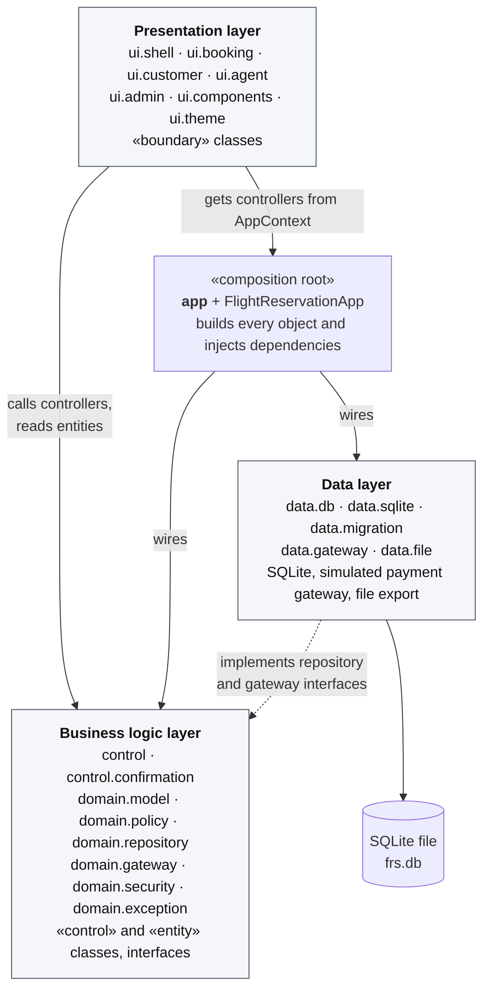
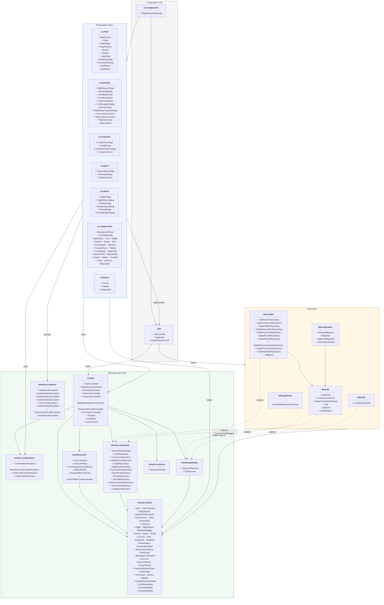

# Package Diagram

| | |
|---|---|
| **Deliverable** | 7.1 G, package diagram (how the three layers interact, the classes in each package, which are public) |
| **Root package** | `ca.ucalgary.frs` |
| **Related** | [Class diagram](../class/domain_class_diagram.md) |

The dependency arrows below were taken from the `import` statements in the source, not drawn by hand. In particular:

- **Presentation never imports the data layer.** Pages reach controllers through `AppContext`.
- **The data layer never imports `control` or `ui`.** It depends only on business-layer interfaces and entities.
- **The business layer owns the interfaces** (`domain.repository`, `domain.gateway`) that the data layer implements,
  so the dependency between business and data points *upward* (dependency inversion).

## G.1 Layer overview

## G.2 Packages and their classes

`+` marks a **public** class, `~` a **package-private** class (visible only inside its own package). Interfaces are
in *italics*.

## Dependency rules (verified against the imports)

| From | May depend on | Never depends on |
|---|---|---|
| Presentation (`ui.*`) | `control`, `control.confirmation`, `domain.model`, `domain.exception`, `app` | `data.*` |
| `control` | `domain.*`, `control.confirmation` | `ui.*`, `data.*` |
| `domain.*` | other `domain.*` packages | `control`, `ui.*`, `data.*` |
| Data (`data.*`) | `domain.model`, `domain.repository`, `domain.gateway`, `domain.exception`, `domain.security` (seeding) | `control`, `ui.*` |
| `app` | everything (it is the only place that calls `new` on repositories and controllers) | — |

Inside the presentation layer, `ui.shell` builds the pages of the feature packages through `PageFactory`, and all
feature packages share `ui.components` and `ui.theme`.

## Why some classes are package-private

| Class | Package | Reason |
|---|---|---|
| `PendingPaymentState`, `ConfirmedState`, `CancelledState`, `CompletedState` | `domain.model` | Only `Reservation` may change its state; outside code goes through `ReservationStatus.state()` |
| `AccessGuard` | `control` | Ownership checks shared by controllers, not an API for the UI |
| `ConfirmationFormats` | `control.confirmation` | Formatting helpers shared by the two renderers |
| `Mappers` | `data.sqlite` | Row-to-entity mapping used only by the SQLite repositories |
| `LoginView`, `RegisterDialog`, `PromotionDialog`, `ShellPanel`, `NavButton` | `ui.shell` | Created and owned by `MainFrame`; no other package needs them |
