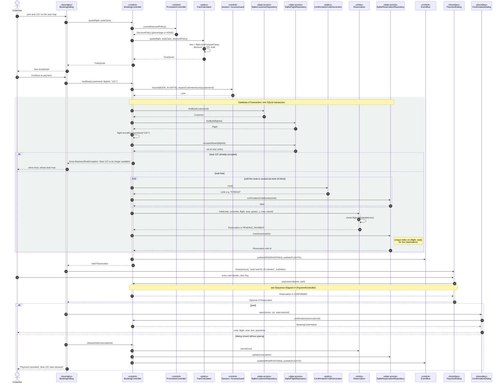

# Sequence Diagram 3 — Book a Flight (`BookingController`)

| | |
|---|---|
| **Deliverable** | 7.1 D, sequence diagram 3 |
| **Use case** | UC-06 Book a flight ([Scenario 2](../usecase/use_case_scenarios.md#scenario-2--uc-06-book-a-flight)) |
| **Control class** | `BookingController` (Facade over reservations, pricing, payments and refunds) |
| **Boundary classes** | `BookingDialog`, `PaymentDialog`, `ConfirmationDialog` |
| **Related diagrams** | [Booking activity](../activity/flight_booking_activity.md), [Reservation state machine](../state/reservation_state_machine.md), [Payment sequence](payment_sequence.md) |

## Diagram

## Notes

- **Race safety:** if two holds for 12C commit at the same moment, the database's partial unique index
  `ux_reservations_live_seat` rejects the second insert. `holdSeat` turns the `DuplicateKeyException` into the same
  "seat was just taken" message as the occupied-seat check.
- **Facade:** the dialog talks only to `BookingController`; pricing, promotions, codes, persistence and payment are
  hidden behind it.
- **Strategy:** `DiscountPolicy` (none or percentage), `RefundPolicy` and `ConfirmationRenderer` (text or HTML) are
  interchangeable strategies injected into or chosen by the controller.
