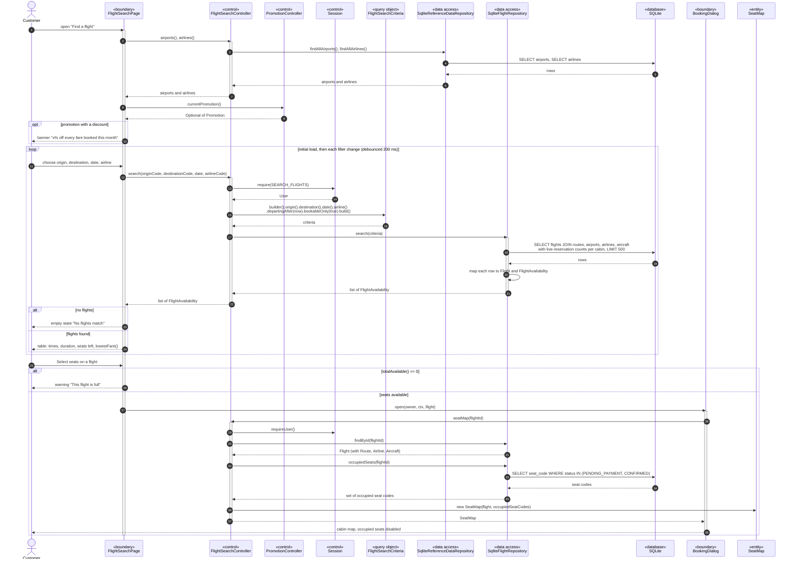

# Sequence Diagram 2 — Search for Flights (`FlightSearchController`)

| | |
|---|---|
| **Deliverable** | 7.1 D, sequence diagram 2 |
| **Use cases** | UC-04 Search for flights, UC-05 View flight details and seat availability ([Scenario 1](../usecase/use_case_scenarios.md#scenario-1--uc-04-search-for-flights-and-select-one)) |
| **Control class** | `FlightSearchController` |
| **Boundary classes** | `FlightSearchPage`, `BookingDialog` |
| **Related diagrams** | [Flight search activity](../activity/flight_search_activity.md), [Flight state machine](../state/flight_state_machine.md) |

## Diagram

## Notes

- **Builder:** `FlightSearchCriteria.Builder` keeps the call readable when most filters are optional (`null` = any).
- **Interface segregation:** `FlightSearchController` depends on the read-only `FlightQueryRepository`, not on
  `FlightRepository`, so search code cannot modify flights.
- **Adapter:** results reach the table through `ListTableModel`, which adapts a `List<FlightAvailability>` to Swing's
  `TableModel`.
