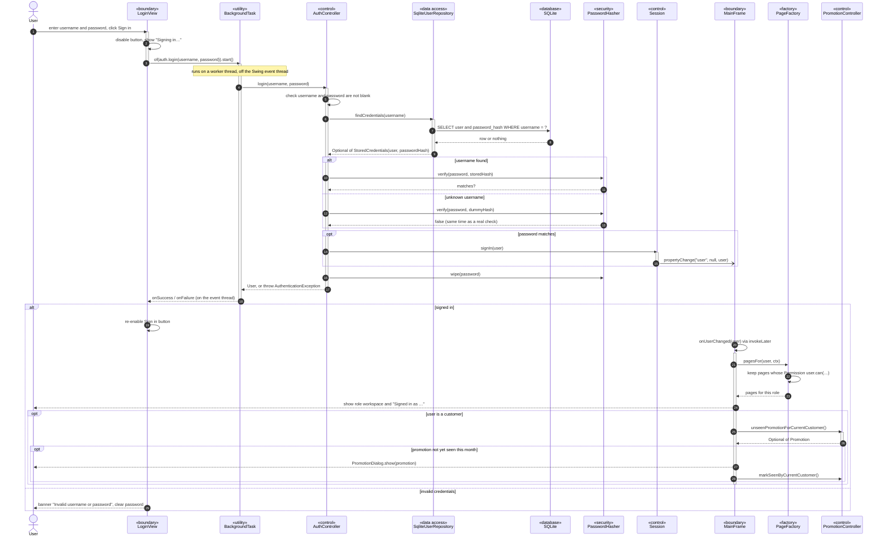

# Sequence Diagram 1 — Log In (`AuthController`)

| | |
|---|---|
| **Deliverable** | 7.1 D, sequence diagram 1 |
| **Use case** | UC-01 Log in ([Scenario 4](../usecase/use_case_scenarios.md#scenario-4--uc-01-log-in)) |
| **Control class** | `AuthController` |
| **Boundary classes** | `LoginView`, `MainFrame`, `PromotionDialog` |
| **Related diagrams** | [Login activity](../activity/login_activity.md), [System state machine](../state/system_state_machine.md) |

## Diagram

## Notes

- **Observer:** `AuthController` does not know about `MainFrame`. It only changes the `Session`; `MainFrame` listens
  for the `user` property and swaps the sign-in screen for the workspace.
- **Factory Method:** `PageFactory` builds the navigation from a registry of *(permission → page)*, so adding a page
  for a role never touches `MainFrame`.
- **Security:** passwords are compared as salted PBKDF2 hashes and the `char[]` buffer is wiped in a `finally` block,
  on success and on failure.
