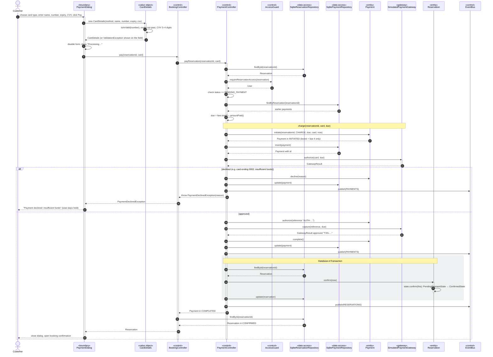

# Sequence Diagram 4 — Make a Payment (`PaymentController`)

| | |
|---|---|
| **Deliverable** | 7.1 D, sequence diagram 4 |
| **Use case** | UC-07 Make a payment ([Scenario 3](../usecase/use_case_scenarios.md#scenario-3--uc-07-make-a-payment)) |
| **Control class** | `PaymentController` |
| **Boundary class** | `PaymentDialog` |
| **External actor** | Payment Gateway (`SimulatedPaymentGateway` behind the `PaymentGateway` interface) |
| **Related diagrams** | [Payment activity](../activity/payment_activity.md), [Payment state machine](../state/payment_state_machine.md) |

## Diagram

## Notes

- **Every attempt is recorded.** The payment row is inserted before the gateway is called and updated afterwards, so a
  decline still appears in payment history with its reason.
- **Payment state rules** live in `PaymentStatus.next()`: `INITIATED → AUTHORIZED | DECLINED`,
  `AUTHORIZED → COMPLETED | DECLINED`, `COMPLETED → REFUNDED`. Any other move throws. See the
  [payment state machine](../state/payment_state_machine.md).
- **Strategy / dependency inversion:** `PaymentController` depends on the `PaymentGateway` interface in the domain
  layer. `SimulatedPaymentGateway` in the data layer is one implementation; a real processor could replace it without
  changing the controller.
- **No card data at rest:** `CardDetails` lives only in memory for the call; `Payment` keeps brand, last 4 digits and
  cardholder name.
