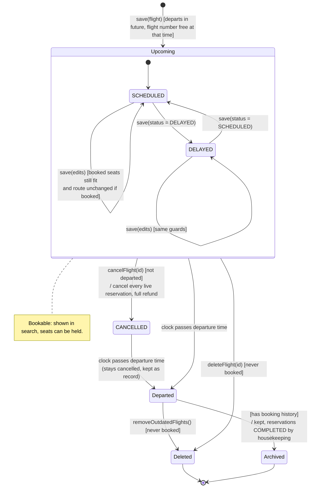

# State Machine 4 — Flight Object

| | |
|---|---|
| **Deliverable** | Supplementary (the brief asks for three state machines; this fourth one supports UC-16 and UC-17) |
| **Implemented by** | `Flight` (`status`, `hasDeparted`, `isBookable`), `FlightStatus` (`SCHEDULED`, `DELAYED`, `CANCELLED`), `FlightManagementController` |
| **Related diagrams** | [Flight search sequence](../sequence/flight_search_sequence.md), [Reservation state machine](reservation_state_machine.md) |

## Description

A flight stores one of three statuses: `SCHEDULED`, `DELAYED` or `CANCELLED`. *Departed* is not stored: it is derived
from the clock (`hasDeparted(now)` is true once the departure time has passed). A flight is **bookable** only while it
is not cancelled and has not departed.

Note: the implementation does not track *Boarding*, *In flight* or *Landed*; the brief does not require live flight
operations, so those states were left out.

## Diagram

| State | Stored as | Bookable | Admin can |
|---|---|:-:|---|
| SCHEDULED / DELAYED (Upcoming) | `status` column | ✓ | edit, delay, cancel, delete if never booked |
| CANCELLED | `status = 'CANCELLED'` | ✗ | nothing (cancelled flights cannot be edited) |
| Departed | derived: `departure_time ≤ now` | ✗ | remove if never booked |
| Archived | departed flight with booking history | ✗ | nothing; kept for history and payments |
| Deleted | row removed | — | — |
