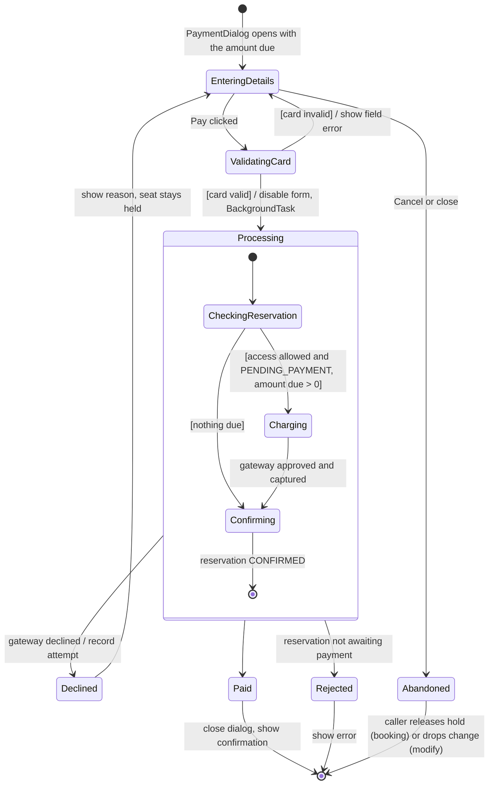
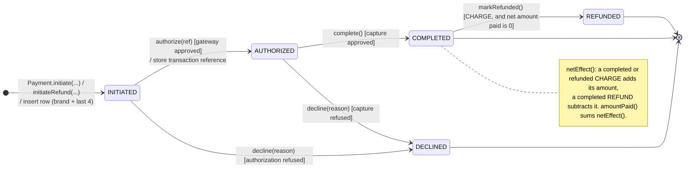

# State Machine 2 — Payment Process

| | |
|---|---|
| **Deliverable** | 7.1 E, state-transition diagram 2 (the payment process) |
| **Implemented by** | `Payment` (`authorize`, `complete`, `decline`, `markRefunded`), `PaymentStatus.next()` / `canMoveTo()`, `PaymentController`, `PaymentDialog` |
| **Related diagrams** | [Payment activity](../activity/payment_activity.md), [Payment sequence](../sequence/payment_sequence.md) |

## 2a. Payment process (what the user goes through)

## 2b. Payment object lifecycle (`PaymentStatus`)

Every charge and every refund is a `Payment` row. Its status can only move along these transitions; any other move
throws `IllegalStateException`.

| Status | Meaning |
|---|---|
| `INITIATED` | Recorded before calling the gateway, so even a crash leaves a trace |
| `AUTHORIZED` | Gateway approved the amount and returned a reference (`AUTH-…`, or `RFD-…` for refunds) |
| `COMPLETED` | Money captured (charge) or returned (refund) |
| `DECLINED` | Gateway refused; `failureReason` explains why. Final. |
| `REFUNDED` | A completed charge whose full amount has since been refunded. Final. |
