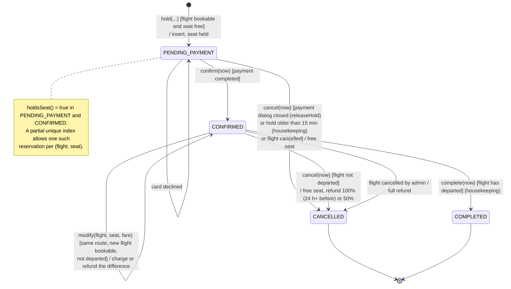

# State Machine 3 — Reservation Object

| | |
|---|---|
| **Deliverable** | 7.1 E, state-transition diagram 3 (a reservation object) |
| **Implemented by** | State pattern: `Reservation` delegates to `ReservationState`, implemented by `PendingPaymentState`, `ConfirmedState`, `CancelledState`, `CompletedState` (one shared instance each). `ReservationStatus` is the persisted value. |
| **Triggered by** | `BookingController` (`holdSeat`, `releaseHold`, `cancel`, `modify`, `runHousekeeping`), `PaymentController.payReservation`, `FlightManagementController.cancelFlight` |
| **Related diagrams** | [Booking activity](../activity/flight_booking_activity.md), [Booking sequence](../sequence/flight_booking_sequence.md) |

## Diagram

## Allowed operations per state

Calling an operation that the state does not allow throws `BusinessRuleException`
("A reservation that is cancelled cannot be changed.").

| State | `confirm` | `cancel` | `modify` | `complete` | Holds seat |
|---|:-:|:-:|:-:|:-:|:-:|
| `PENDING_PAYMENT` | ✓ → CONFIRMED | ✓ → CANCELLED | ✗ "Complete payment before changing" | ✗ | ✓ |
| `CONFIRMED` | ✗ | ✓ → CANCELLED (not after departure) | ✓ stays CONFIRMED | ✓ → COMPLETED | ✓ |
| `CANCELLED` | ✗ | ✗ | ✗ | ✗ | ✗ |
| `COMPLETED` | ✗ | ✗ | ✗ | ✗ | ✗ |
