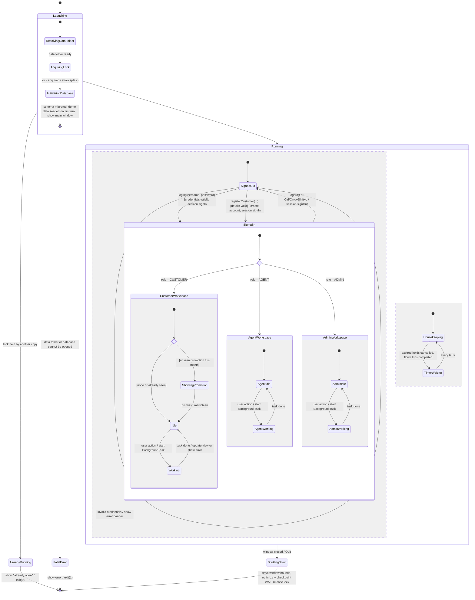

# State Machine 1 — Overall System

| | |
|---|---|
| **Deliverable** | 7.1 E, state-transition diagram 1 (state of the overall system) |
| **Implemented by** | `FlightReservationApp` (start-up and shutdown), `SingleInstanceLock`, `SchemaMigrator`, `Session` + `MainFrame` (signed in / out), `BookingController.runHousekeeping()` (timer) |
| **Related diagrams** | [Login activity](../activity/login_activity.md), [Login sequence](../sequence/login_sequence.md) |

## Description

The application is a single-user desktop program. It starts by resolving its data folder and taking a file lock so a
second copy cannot open the same database. It then opens (and on first run creates and seeds) the SQLite database
behind a splash screen. Once running, two things happen in parallel:

- the **user session** moves between *Signed out* and a role-specific *Signed in* workspace;
- a **housekeeping timer** fires at start-up and every 60 seconds to release expired seat holds and complete flown trips.

Closing the window runs a shutdown hook that optimizes and checkpoints the database and releases the lock.

## Diagram

## States

| State | Meaning | In code |
|---|---|---|
| Launching | Data folder, single-instance lock, database start-up | `FlightReservationApp.start()` |
| AlreadyRunning | Another copy holds the lock | `SingleInstanceLock.tryAcquire()` returns empty |
| FatalError | Data folder or database could not be opened | `FlightReservationApp.fatal(…)` |
| SignedOut | Sign-in screen visible; no user in the session | `Session.currentUser()` empty, `MainFrame` shows `LoginView` |
| SignedIn | Role workspace with pages from `PageFactory` | `Session.currentUser()` present, `MainFrame` shows `ShellPanel` |
| Working | A database or gateway call is running off the event thread; the view shows a skeleton or progress state | `BackgroundTask` (Template Method over `SwingWorker`) |
| Housekeeping | Releases holds older than 15 min, completes trips whose flight has departed | `BookingController.runHousekeeping()` on a 60 s `javax.swing.Timer` |
| ShuttingDown | Shutdown hook | `Database.optimizeAndCheckpoint()`, `SingleInstanceLock.close()` |
