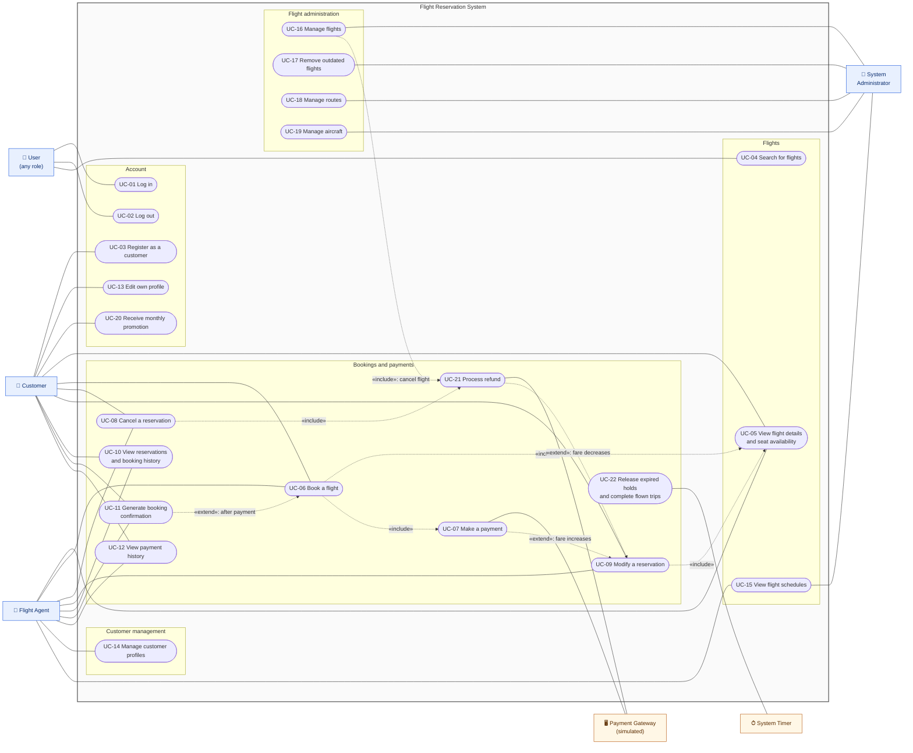
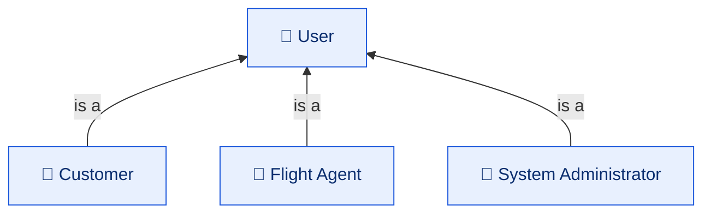

# System Use-Case Diagram

| | |
|---|---|
| **Deliverable** | 7.1 B, system use-case diagram |
| **Actors** | Customer, Flight Agent, System Administrator (primary); Payment Gateway, System Timer (secondary) |
| **Related** | [Use-case scenarios](use_case_scenarios.md), [Traceability matrix](../README.md#traceability-matrix) |

## Actors

| Actor | Kind | Description |
|---|---|---|
| **User** | Abstract primary | Anyone with an account. Generalizes the three roles below and owns *Log in* and *Log out*. |
| **Customer** | Primary | End user who books flights for themselves. Can self-register. |
| **Flight Agent** | Primary | Employee who manages customers and any customer's bookings, and views schedules. |
| **System Administrator** | Primary | Maintains flights, routes, aircraft and schedules. Books nothing. |
| **Payment Gateway** | Secondary (external) | Authorizes, captures and refunds card payments. Simulated (requirement 3.5). |
| **System Timer** | Secondary | Fires at start-up and every 60 seconds to run housekeeping. |

## Diagram

Mermaid has no native use-case notation, so the diagram uses a flowchart: actors are person nodes, use cases are
ovals inside the system boundary (grouped by area), and `«include»` / `«extend»` are dashed arrows. The three roles
specialize the abstract **User** actor, shown in the [actor hierarchy](#actor-hierarchy) below; *Log in*, *Log out*
and *Search for flights* belong to every User.

### Actor hierarchy

The roles are a generalization hierarchy, mirrored in code by the abstract `User` class and its subclasses
`CustomerUser`, `FlightAgent` and `SystemAdministrator`.

## Use-case catalogue

| ID | Use case | Actors | Requirement | Control class |
|---|---|---|---|---|
| UC-01 | Log in | User | §2.1 roles | `AuthController` |
| UC-02 | Log out | User | §2.1 roles | `AuthController` |
| UC-03 | Register as a customer | Customer | 3.3 | `AuthController` |
| UC-04 | Search for flights (origin, destination, date, airline) | User | 3.1 | `FlightSearchController` |
| UC-05 | View flight details and seat availability (seat map, times, prices) | Customer, Agent | 3.1 | `FlightSearchController` |
| UC-06 | Book a flight (hold a seat, then pay) | Customer, Agent | 3.2 | `BookingController` |
| UC-07 | Make a payment | Customer, Agent, Payment Gateway | 3.5 | `PaymentController` |
| UC-08 | Cancel a reservation (refund by policy) | Customer (own), Agent (any) | 3.2 | `BookingController` |
| UC-09 | Modify a reservation (new seat, or another flight on the same route) | Customer (own), Agent (any) | 3.2 | `BookingController` |
| UC-10 | View reservations and booking history | Customer (own), Agent (any) | §2 overview | `BookingController`, `CustomerController` |
| UC-11 | Generate booking confirmation (view, save as .txt or .html) | Customer, Agent | 3.2 | `BookingController` |
| UC-12 | View payment history | Customer (own), Agent (any) | 3.5 | `CustomerController`, `PaymentController` |
| UC-13 | Edit own profile | Customer | 3.3 | `CustomerController` |
| UC-14 | Manage customer profiles (create, view, edit) | Agent | 3.3 | `CustomerController` |
| UC-15 | View flight schedules | Agent, Administrator | §2.1 roles | `FlightSearchController` |
| UC-16 | Manage flights (add, update, delay, cancel, delete) | Administrator | 3.4 | `FlightManagementController` |
| UC-17 | Remove outdated flights | Administrator | 3.4 | `FlightManagementController` |
| UC-18 | Manage routes | Administrator | §2.1 roles | `RouteAndAircraftController` |
| UC-19 | Manage aircraft | Administrator | §2.1 roles | `RouteAndAircraftController` |
| UC-20 | Receive monthly promotion (random pick, shown once a month) | Customer | 3.7 | `PromotionController` |
| UC-21 | Process refund | Payment Gateway | 3.2, 3.5 | `PaymentController` |
| UC-22 | Release expired holds and complete flown trips | System Timer | Additional (reliability) | `BookingController` |

Requirement 3.6 (embedded database) is non-functional from the user's point of view; it is realized by the data
layer shown in the [package diagram](../package/package_diagram.md).
