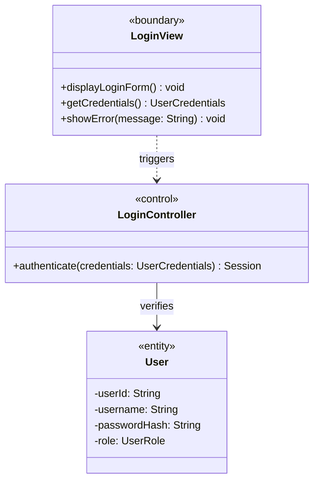

# Technical Implementation Plan: UML to Mermaid.js Migration & Documentation Architecture

**Project:** Flight Reservation System (ENSF 614 Term Project)  
**Target Path:** `documentation/diagrams/`  
**Plan Location:** Root (`./UML_MERMAID_IMPLEMENTATION_PLAN.md`)

---

## 1. Executive Summary & Objective

This technical plan defines the roadmap for specifying, modeling, converting, and organizing all required UML design artifacts for the **ENSF 614 Flight Reservation System** project into version-controlled Markdown documents with embedded **Mermaid.js** diagrams.

Per the course specification (`documentation/ENSF_614_Term_Project.pdf`), the design deliverables account for **50% of the project evaluation** and demand strict consistency across use cases, interaction sequences, state machines, domain models, and package boundaries.

---

## 2. Inventory of Required Diagrams (ENSF 614 Requirements)

The following matrix identifies all mandatory diagrams extracted directly from the specification:

| Diagram Category | Specific Diagram Target | Mermaid Type | Output File Target |
| :--- | :--- | :--- | :--- |
| **Activity Diagrams (4)** | 1. User Authentication / Login Flow | `stateDiagram-v2` / `flowchart TD` | `documentation/diagrams/activity/login_activity.md` |
| | 2. Flight Browsing & Selection Flow | `stateDiagram-v2` / `flowchart TD` | `documentation/diagrams/activity/flight_search_activity.md` |
| | 3. Ticket Booking & Seat Reservation Flow | `stateDiagram-v2` / `flowchart TD` | `documentation/diagrams/activity/flight_booking_activity.md` |
| | 4. Payment Execution & Receipt Flow | `stateDiagram-v2` / `flowchart TD` | `documentation/diagrams/activity/payment_activity.md` |
| **Use-Case Model** | System Use-Case Diagram (Customer, Flight Agent, Admin) | `flowchart LR` / `quadrantChart` | `documentation/diagrams/usecase/use_case_diagram.md` |
| **Use-Case Scenarios** | Detailed Storyboarding & Traceability (Underlined Entities & Operations) | Markdown + tabular specs | `documentation/diagrams/usecase/use_case_scenarios.md` |
| **Interaction Diagrams (4)** | 1. Sequence: Authenticate User (`LoginController`) | `sequenceDiagram` | `documentation/diagrams/sequence/login_sequence.md` |
| | 2. Sequence: Search Flights (`FlightSearchController`) | `sequenceDiagram` | `documentation/diagrams/sequence/flight_search_sequence.md` |
| | 3. Sequence: Book Flight & Reserve Seat (`BookingController`) | `sequenceDiagram` | `documentation/diagrams/sequence/flight_booking_sequence.md` |
| | 4. Sequence: Process Simulated Payment (`PaymentController`) | `sequenceDiagram` | `documentation/diagrams/sequence/payment_sequence.md` |
| **State Machine Diagrams (4)**| 1. Entire System Lifecycle States | `stateDiagram-v2` | `documentation/diagrams/state/system_state_machine.md` |
| | 2. Payment Lifecycle States | `stateDiagram-v2` | `documentation/diagrams/state/payment_state_machine.md` |
| | 3. Reservation Object Lifecycle States | `stateDiagram-v2` | `documentation/diagrams/state/reservation_state_machine.md` |
| | 4. Flight Object Lifecycle States | `stateDiagram-v2` | `documentation/diagrams/state/flight_state_machine.md` |
| **Domain Class Diagram** | Layered Class Model with Stereotypes (`<<boundary>>`, `<<control>>`, `<<entity>>`), Multiplicities, Associations | `classDiagram` | `documentation/diagrams/class/domain_class_diagram.md` |
| **Package Diagram** | 3-Layer Architectural Boundaries (Presentation, Business Logic, Data Layer) | `classDiagram` / `flowchart TB` | `documentation/diagrams/package/package_diagram.md` |

---

## 3. Directory & File Structure

All diagrams will be encapsulated in dedicated Markdown files under `documentation/diagrams/`. A top-level catalog (`README.md`) will serve as the index.

```text
flight-reservation-system/
│
├── UML_MERMAID_IMPLEMENTATION_PLAN.md      <-- [Root Implementation Plan]
├── documentation/
│   ├── ENSF_614_Term_Project.pdf          <-- Course Specification
│   └── diagrams/
│       ├── README.md                      <-- Master Index & Traceability Matrix
│       ├── activity/
│       │   ├── login_activity.md
│       │   ├── flight_search_activity.md
│       │   ├── flight_booking_activity.md
│       │   └── payment_activity.md
│       ├── usecase/
│       │   ├── use_case_diagram.md
│       │   └── use_case_scenarios.md
│       ├── sequence/
│       │   ├── login_sequence.md
│       │   ├── flight_search_sequence.md
│       │   ├── flight_booking_sequence.md
│       │   └── payment_sequence.md
│       ├── state/
│       │   ├── system_state_machine.md
│       │   ├── payment_state_machine.md
│       │   ├── reservation_state_machine.md
│       │   └── flight_state_machine.md
│       ├── class/
│       │   └── domain_class_diagram.md
│       └── package/
│           └── package_diagram.md
```

---

## 4. Mermaid.js Conventions & Standards

To ensure consistency, readability, and compliance with ENSF 614 grading criteria, all diagrams must adhere to the following conventions:

### 4.1 Class Diagram Standards
- **Stereotypes:** Every class MUST display its architectural stereotype: `<<boundary>>`, `<<control>>`, `<<entity>>`, or `<<data_access>>`.
- **Exclusions:** As per guidelines, omit standard constructors/destructors, trivial getters/setters, and generic Java standard library utilities (`String`, `ArrayList`, `Exception`).
- **Visibility:** Use standard UML markers: `+` (public), `-` (private), `#` (protected), `~` (package).
- **Design Pattern Annotations:** Explicitly model patterns (e.g., `Observer` for Monthly Promotion News, `Singleton` for Database Connection Pool, `Strategy` for Payment Calculation).



### 4.2 Sequence Diagram Standards
- Show clear message lifelines originating from Boundary/GUI classes, delegating through Control classes, into Domain Entities, and terminating at the Persistence/Database Layer.
- Use activation/deactivation blocks (`activate`, `deactivate`) to accurately portray call durations.
- Include return messages with dashed lines (`-->>`).

### 4.3 Activity Diagram Standards
- Represent decision branches clearly using `if / else / endif` blocks in `flowchart TD` or state-based control flow in `stateDiagram-v2`.
- Capture error handling (e.g., invalid payment credentials, seat already reserved, flight cancelled).

### 4.4 State Transition Standards
- Use `[*]` for entry and exit pseudostates.
- Label transitions with `[Event / Condition] --> Action`.

---

## 5. Phased Execution Roadmap

### Phase 1: Directory Setup & Scaffold Generation
- Initialize folder hierarchy: `documentation/diagrams/{activity,usecase,sequence,state,class,package}`.
- Create template headers and metadata in each target `.md` file.

### Phase 2: Use-Case Model & Scenarios
- Construct the system use-case diagram defining relationships for:
  - **Customer:** Search Flights, Select Seat, Book Ticket, View Itinerary, Cancel/Modify Booking, Opt-in/Receive Monthly Promotion.
  - **Flight Agent:** View Flight Schedules, Assist Customer Booking, Manage Seat Inventory.
  - **System Administrator:** Add/Modify/Remove Flights, Manage Aircraft/Routes, Audit System Logs.
- Author detailed textual scenarios with underlined entities and double-underlined operations for traceability.

### Phase 3: Activity & State Machine Modeling
- Implement the 4 activity workflows (Login, Flight Search, Flight Booking, Payment).
- Implement the 4 state machines (System, Payment, Reservation, Flight lifecycle states: `Scheduled`, `Boarding`, `In-Flight`, `Landed`, `Cancelled`, `Delayed`).

### Phase 4: Interaction (Sequence) Modeling
- Create sequence diagrams mapped directly to the 4 primary control classes:
  - `LoginController`
  - `FlightSearchController`
  - `BookingController`
  - `PaymentController`
- Verify parity with GUI boundary inputs and database operations.

### Phase 5: Domain Class & Package Diagrams
- Construct the unified Domain Class Diagram enforcing strict 3-tier layering and stereotype tags.
- Construct the Package Diagram showing inter-package dependencies between Presentation (`gui`), Logic (`controller`, `model`), and Persistence (`database`).

### Phase 6: Cross-Artifact Traceability & Quality Audit
- Cross-reference use-case operations against class methods.
- Confirm full compliance with ENSF 614 grading rubrics (modularity, low coupling, high cohesion, design patterns).

---

## 6. Verification Checklist

- [ ] All 4 activity diagrams present and rendering in GitHub / VS Code Mermaid previewers.
- [ ] System use-case diagram includes Customer, Agent, and Administrator actors.
- [ ] 4 sequence diagrams explicitly involve the matching `<<control>>` classes.
- [ ] 4 state machine diagrams cover System, Payment, Reservation, and Flight.
- [ ] Class diagram strictly excludes boilerplate getters/setters while preserving associations and multiplicity markers.
- [ ] Package diagram illustrates clear 3-tier layering (Presentation $\rightarrow$ Business Logic $\rightarrow$ Data Access).
- [ ] Central catalog in `documentation/diagrams/README.md` links to all components.